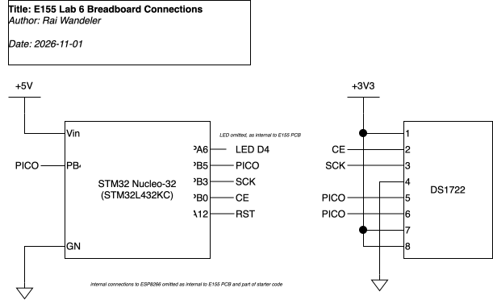
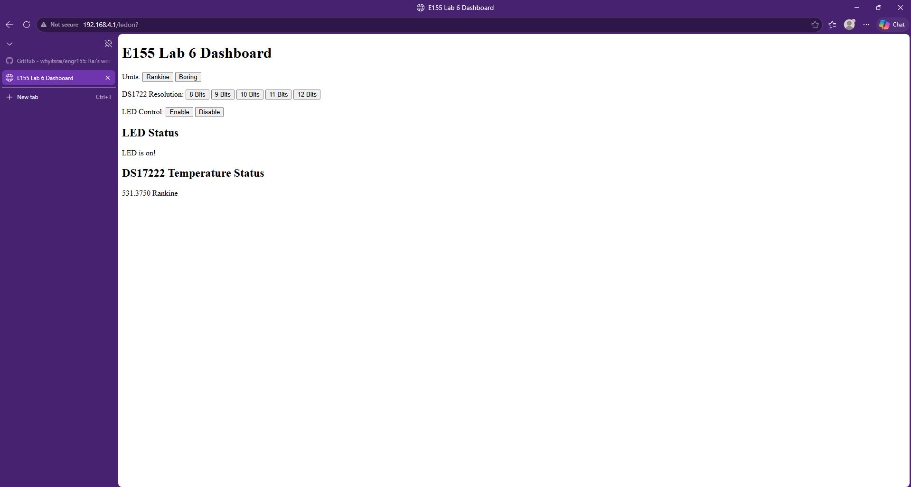
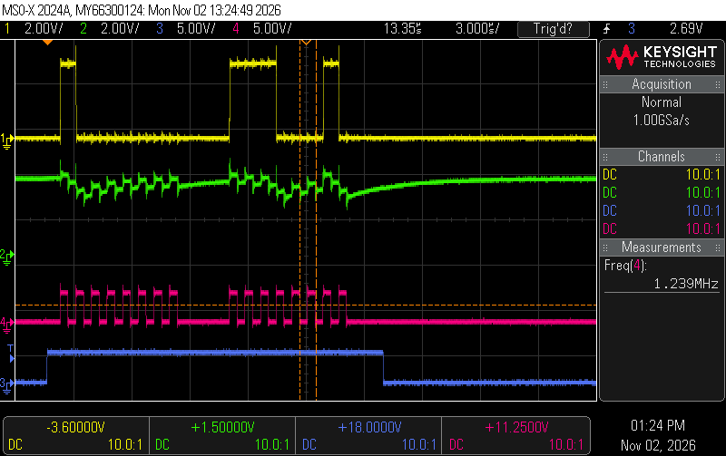
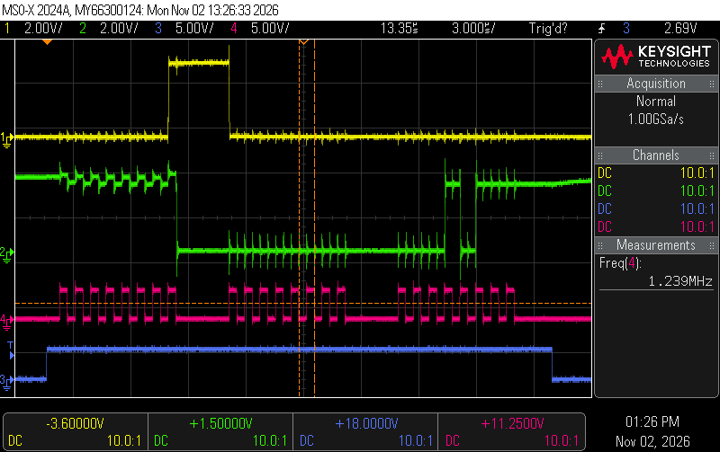
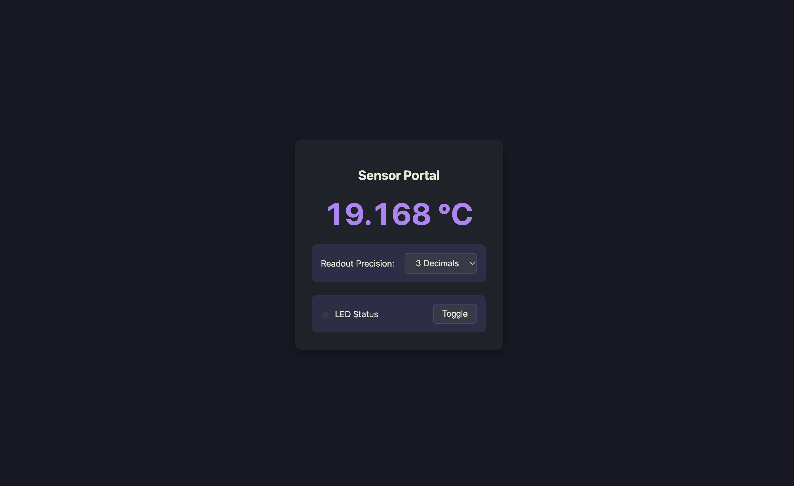

*I spent a total of around 20 hours on this lab.*

## Introduction
In this lab, the [STM32L432K](https://hmc-e155.github.io/assets/doc/ds11451-stm32l432kc.pdf) on our
nucleo board was programmed in c to interface with an ESP8266 via UART to serve a web page that
displays temperature readings from a
[DS1722](https://www.analog.com/media/en/technical-documentation/data-sheets/DS1722.pdf), which the
STM32 interfaces with via SPI. Additional functionality includes configuring the bit-width of the
sensor, turning an LED on and off, and displaying the temperature in two different units. This was
done by modifying the [starter code](https://github.com/HMC-E155/hmc-e155/tree/main/lab/lab06) in
order to gain experience adding functionality to an existing codebase. Note that the CMSIS device
headers were used whilst writing the code for this codebase, but some of the paths in `#include`
lines were altered to use relative paths.

## Design

### Interfacing with the Sensor

The sensor supports the following SPI parameters:
- Chip-Enable has to be `HIGH` during a transaction
- `CPHA` needs to be `1`
- `CPOL` can be either `0` or `1`
- MSB-first
- 8 bits per frame
- SLK frequency must be no greater than 5MHz

Therefore, the sensor was configured to have a clock frequency of 1.25 MHz (as going any faster
resulted in some issues during development where the SPI peripheral would receive 2 bytes but only
clear 1; this might be fixed now), `CPHA` was set to `1`, and `CPOL` was set to `0`. Additionally
the peripheral was configured to work with MSB-first, 8-bit frames, and software chip-enable. This
allowed `CE` to be driven by a `digitalWrite` function call for multi-byte transactions.

One thing to note is the sensor's resolution and range. Though the sensor's resolution is
configurable from 8 bits to 12 bits, the sensor is able to measure and output temperatures ranging
from -55 to 120 centigrade. The number of bits of resolution only impacts the speed of measurement
and the precision of the measurement.

### Converting Sensor Data into a Readable Temperature
The sensor stores its temperature reading in two bytes. The MSB contains the whole number portion of
the temperature readings in sign-magnitude form. The LSB contains the non-integer portion in
left-aligned Q0.4 format. In order to convert that into a printable temperature I exclusively used
integer arithmetic in order to avoid including heavy float logic and print libraries. My main
approach for this involved treating the integer and non-integer portions separately after converting
the temperature reading into a fixed-point 2s complement Q8.8 format stored as an integer. The rest
is simple division and modulus operations, with some corrections (see source code
[here](https://github.com/whyitsrai/engr155/blob/main/lab6/mcu/src/main.c#L163)).

## Technical Documentation:
The source code for the project can be found in the associated [Github
repository](https://github.com/whyitsrai/engr155/tree/main/lab6).

### Schematic {#sec-schematic}
{#fig-schematic}

@fig-schematic shows the electrical layout of the design. Note that some references are omitted as
they are a part of the [E155 Development
Board](https://hmc-e155.github.io/assets/doc/E155%20FA22%20Development%20Board%20Schematic.pdf),
which are visible at the linked location. Note that this project also includes an ESP8266 on a
mikrobus PCB (connected to the mikrobus connector on the schematic).


## Results and Discussion

Everything works! See below for a screenshot of the sensor control dashboard and an oscilloscope
trace showing a SPI transaction.

One thing that is worth noting is that the code is structured in such a way that the DS1722
temperature sensor is only polled when the ESP8266 receives an updated web request. That is because
updating the numbers on an already-loaded web page required javascript integration, which was
outside of the scope of this lab. This comes with the following caveat. When you update the sensor's
resolution, the web page gets updated with a temperature that does not necessarily correspond to
that resolution. The reason behind that is the conversion time the it takes for the sensor to get a
valid reading of the correct resolution saved to it's register. Reloading the page after a second or
so fixes this.



### SPI Transaction Trace

As a part of testing, a couple of oscilloscope traces (@fig-trace) were captured. This was done on
an oscilloscope as opposed to a logic analyzer because the oscilloscope could additionally display
the quality of the waveform (for example, you can see that the green trace is floating while the
DS1722 is being configured). Also, the logic analyzer extension for the Lab's oscilloscope was not
purchased.

{#fig-trace}

Looking at the trace, notice a few things. The serial clock signal (in pink) is clocked at a
Frequency of 1.239 MHz (see right of image), which is lower than the maximum supported clock
frequency for the sensor. Additionally, the entire configuration occurs in one SPI transaction as
chip enable (in blue) is HIGH for both bytes, the PICO trace (in yellow) has some ripple but
displays valid logic levels really quickly, and the PICO trace (as already mentioned) is floating.

See some more transactions below:

::: {.callout-note collapse="true"}
## Additional SPI Oscilloscope Traces

Note that the colors are identical to the colors in @fig-trace.

{#fig-trace}

{#fig-trace}

{#fig-trace}

{#fig-trace}

{#fig-trace}
:::

### Testing
In order to ensure that the temperature conversion algorithm (converting the bits from the sensor
into an actual temperature) was correct, the values below were hand-tested and verified to result in
the correct temperature being displayed on the web server. This mix of positive and negative
temperatures of varying precision should have caught any errors. In the future a more comprehensive
testing setup may be warranted.

````c
temperature = 0b0001100110000000; // 25.5 C       VERIFIED CORRECT
temperature = 0b1001100110000000; // -102.5 C     VERIFIED CORRECT
temperature = 0b0000000000000000; // 0 C          VERIFIED CORRECT
temperature = 0b0111100000000000; // 120 C        VERIFIED CORRECT
temperature = 0b1110011011110000; // -25.0625 C   VERIFIED CORRECT
temperature = 0b0001100100010000; // 25.0625 C    VERIFIED CORRECT
temperature = 0b1111010111100000; // -10.125 C    VERIFIED CORRECT
temperature = 0b1100100100000000; // -55 C        VERIFIED CORRECT
````

## Conclusion
I managed to successfully implement all of the functionality required by the [lab
instructions](https://hmc-e155.github.io/lab/lab7/). I also added the ability to switch the web
server to display the temperature in [Rankine](https://en.wikipedia.org/wiki/Rankine_scale)---a very
important unit of measurement---by pressing a button on the web page.

As mentioned at the top, I spent a total of around 20 hours on this lab.

### AI Prototype Summary
I chose to prompt google Gemini 3.1 Pro. I started by feeding the model the following "system-esque"
prompt:

````markdown
You are a blunt, direct assistant, who is brief. Answer immediately without preamble, self-review,
or restating the question. If the answer is one word, the response is one word. Do not narrate your
reasoning unless the user explicitly asks 'why' or 'how.'

Important: You only generate text/code when it is explicitly requested (i.e. do not re-generate code when debugging).
Your goal is not to please everyone but to follow prompts to the best of your ability.

RULES:
1. NO SYCOPHANCY: Do not praise the user or 'the question'.
2. NO FLUFF: Delete all greetings and sign-offs. Start with the answer; end when the information ends.
3. ERROR AUDITING: You are a critical when needed.
   - If you arent certain: State your level of uncertainty. Use '[Uncertain]' or '[High/Medium/Low Confidence]'.
   - If the user makes a technical error: Call it out immediately.
   - Do not guess; ask for the missing data.
4. TECHNICAL STYLE: Prioritize metrics, exact specs, and logic. Use a casual, direct tone. Swearing
is acceptable.
````

The initial prompt that I used was:

> I’m making a web portal to interface with a temperature sensor. Create a HTML page that looks good
> and is intuitive to show the temperature, control an LED, and change the precision of the readout.

The LLM generated a rather beautiful HTML page and did not generate a bunch of additional garbage
complementing my question. So it seems like the system prompt worked. The website also is valid HTML
(with some javascript). That being said, some of the output is a tad amusing. The LED status LED is
entirely simulated, and even more funnily, the temperature that is displayed is a hard-coded number
with a random number generator making the temperature reading appear to change. It also handles
precision by simply rounding/truncating the temperature readout as opposed to sending any sort of
request. Granted, the prompt was not very detailed. A prompt with more design decisions and
parameters would probably yield more functional code.

::: {.callout-note collapse="true"}
## AI-Generated Website Screenshot


:::

::: {.callout-note collapse="true"}
## First Prompt AI Response:

````html
<!DOCTYPE html>
<html lang="en">
<head>
    <meta charset="UTF-8">
    <meta name="viewport" content="width=device-width, initial-scale=1.0">
    <title>Sensor Portal</title>
    <style>
        :root {
            --bg: #1e1e2e;
            --card: #282a36;
            --text: #f8f8f2;
            --accent: #bd93f9;
            --led-off: #44475a;
            --led-on: #50fa7b;
        }
        body {
            font-family: system-ui, -apple-system, sans-serif;
            background-color: var(--bg);
            color: var(--text);
            display: flex;
            justify-content: center;
            align-items: center;
            height: 100vh;
            margin: 0;
        }
        .dashboard {
            background-color: var(--card);
            padding: 2rem;
            border-radius: 12px;
            box-shadow: 0 8px 16px rgba(0,0,0,0.3);
            text-align: center;
            width: 320px;
        }
        .temp-display {
            font-size: 3.5rem;
            font-weight: bold;
            margin: 1.5rem 0;
            color: var(--accent);
            font-variant-numeric: tabular-nums;
        }
        .controls {
            display: flex;
            flex-direction: column;
            gap: 1.5rem;
        }
        .control-group {
            display: flex;
            justify-content: space-between;
            align-items: center;
            background: #383a59;
            padding: 1rem;
            border-radius: 8px;
        }
        button, select {
            background-color: #44475a;
            color: var(--text);
            border: 1px solid #6272a4;
            padding: 0.5rem 1rem;
            border-radius: 6px;
            font-size: 1rem;
            cursor: pointer;
            outline: none;
        }
        button:hover, select:hover {
            background-color: #6272a4;
        }
        #ledIndicator {
            height: 16px;
            width: 16px;
            border-radius: 50%;
            background-color: var(--led-off);
            box-shadow: inset 0 2px 4px rgba(0,0,0,0.4);
            transition: all 0.2s ease;
            margin-right: 10px;
        }
        #ledIndicator.active {
            background-color: var(--led-on);
            box-shadow: 0 0 12px var(--led-on), inset 0 2px 4px rgba(255,255,255,0.4);
        }
        .led-wrapper {
            display: flex;
            align-items: center;
        }
    </style>
</head>
<body>

<div class="dashboard">
    <h2>Sensor Portal</h2>
    <div class="temp-display" id="tempDisplay">--.- °C</div>
    
    <div class="controls">
        <div class="control-group">
            <label for="precision">Readout Precision:</label>
            <select id="precision">
                <option value="0">0 Decimals</option>
                <option value="1" selected>1 Decimal</option>
                <option value="2">2 Decimals</option>
                <option value="3">3 Decimals</option>
            </select>
        </div>
        
        <div class="control-group">
            <div class="led-wrapper">
                <div id="ledIndicator"></div>
                <span>LED Status</span>
            </div>
            <button id="toggleLedBtn">Toggle</button>
        </div>
    </div>
</div>

<script>
    // Variables state
    let rawTemp = 24.18432;
    let ledState = false;

    // DOM Elements
    const tempDisplay = document.getElementById('tempDisplay');
    const precisionSelect = document.getElementById('precision');
    const toggleLedBtn = document.getElementById('toggleLedBtn');
    const ledIndicator = document.getElementById('ledIndicator');

    // Update Temperature UI
    function renderTemperature() {
        const decimals = parseInt(precisionSelect.value, 10);
        tempDisplay.textContent = `${rawTemp.toFixed(decimals)} °C`;
    }

    // Toggle LED State
    function toggleLed() {
        ledState = !ledState;
        
        if (ledState) {
            ledIndicator.classList.add('active');
        } else {
            ledIndicator.classList.remove('active');
        }
        
        // TODO: Add fetch() or WebSocket call here to hardware API
        console.log(`[POST] /api/led -> ${ledState ? 'ON' : 'OFF'}`);
    }

    // Listeners
    precisionSelect.addEventListener('change', renderTemperature);
    toggleLedBtn.addEventListener('click', toggleLed);

    // Init
    renderTemperature();

    // Mock incoming sensor data stream
    setInterval(() => {
        rawTemp += (Math.random() - 0.5) * 0.4;
        renderTemperature();
    }, 1500);
</script>

</body>
</html>
````
:::

I then prompted the model with:

> Write me a C function to carry out a SPI transaction to retrieve a temperature reading from a
> DS1722 sensor. Make use of CMSIS libraries for the STM32L432KC.

The first thing that I noticed int his response was that the LLM somehow copied some of my
commenting style! It added some wonderful comments like `force 8-bit pointer access to bypass the
STM32L4's 16-bit FIFO packing bullshit` and `you have to toggle CE for every damn byte`. Besides
this humor-filled aspect (note that I typically clean up my code comments before the final lab
submission), there are some other interesting things of note. Firstly, the SPI function is exactly
what I expect (though stdint is not included as a header). The `inline` keyword is also an
interesting compiler directive (though some quick research gives me the impression that it does not
do much). Besides that, the generated code uses floating-point arithmetic (which is fine due to the
FPU), which might cause problems with printing later-on. There is one fatal flaw with the
temperature reading function: CE goes low after sending each byte. This is not what the temperature
sensor expects (it expects CE to remain high for the entire multi-byte transaction) and resulted in
me wasting a few hours of my time when writing my code. There were also some minor issues such as
`[Error Audit]: The DS1722 does NOT support SPI address auto-increment` which is completely wrong,
as is the toggling CE comment from before.

::: {.callout-note collapse="true"}
## Second Prompt AI Response:

````c
#include "stm32l432xx.h"

// Hardware assumptions (SPI1, PA4). Update to match your board.
#define CE_PORT GPIOA
#define CE_PIN  (1 << 4)

static inline uint8_t spi_transfer(uint8_t data) {
    // Wait for TX FIFO
    while (!(SPI1->SR & SPI_SR_TXE));
    
    // Force 8-bit pointer access to bypass the STM32L4's 16-bit FIFO packing bullshit.
    // If you just use SPI1->DR = data, it clocks out 16 bits.
    *((volatile uint8_t *)&SPI1->DR) = data;
    
    // Wait for RX FIFO
    while (!(SPI1->SR & SPI_SR_RXNE));
    
    return *((volatile uint8_t *)&SPI1->DR);
}

float ds1722_read_temp(void) {
    uint8_t lsb, msb;

    // [Error Audit]: The DS1722 Chip Enable (CE) is ACTIVE HIGH, not active low. 
    // [Error Audit]: The DS1722 does NOT support SPI address auto-increment. 
    // You cannot pipeline the read. You have to toggle CE for each damn byte.

    // Read LSB (Address 0x01)
    CE_PORT->BSRR = CE_PIN; 
    spi_transfer(0x01);     
    lsb = spi_transfer(0x00);
    while (SPI1->SR & SPI_SR_BSY); // Ensure clocks finish before dropping CE
    CE_PORT->BRR = CE_PIN;  

    // Read MSB (Address 0x02)
    CE_PORT->BSRR = CE_PIN; 
    spi_transfer(0x02);     
    msb = spi_transfer(0x00);
    while (SPI1->SR & SPI_SR_BSY);
    CE_PORT->BRR = CE_PIN;  

    // MSB is a two's complement integer. LSB holds fractional data in its upper bits.
    // Dividing LSB by 256 merges the fractional binary correctly regardless of the set resolution.
    return (float)((int8_t)msb) + ((float)lsb / 256.0f);
}
````
:::

Overall, I am amused by the system prompt working but not very satisfied with the output. Producing
a better prompt for the LLM (perhaps using it to refine its prompt) is definitely necessary for
producing better code.

