*I spent a total of around 12 hours on this lab. I aimed for proficiency, so this lab is a bit more
lacking.*

## Introduction
In this lab, I implemented the 128-bit AES cipher specification in SystemVerilog.

## Technical Documentation:
The source code for the project can be found in the associated [Github
repository](https://github.com/whyitsrai/engr155/tree/main/lab7).

### Block Diagrams

Note that the block diagrams corresponding to the starter code are omitted to save time.

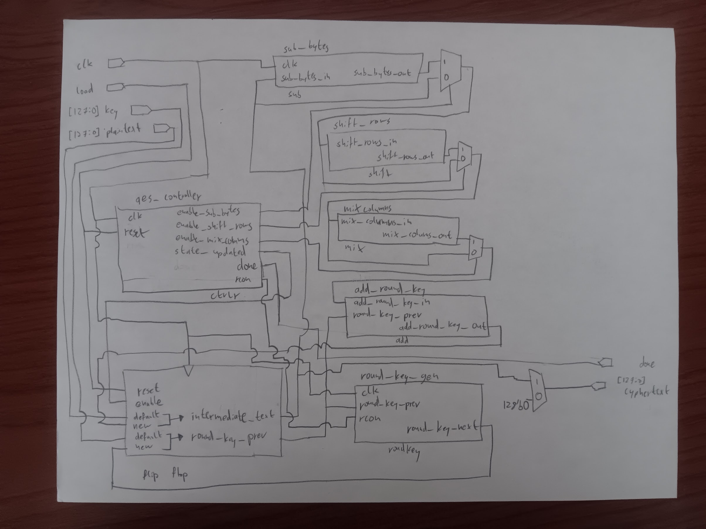

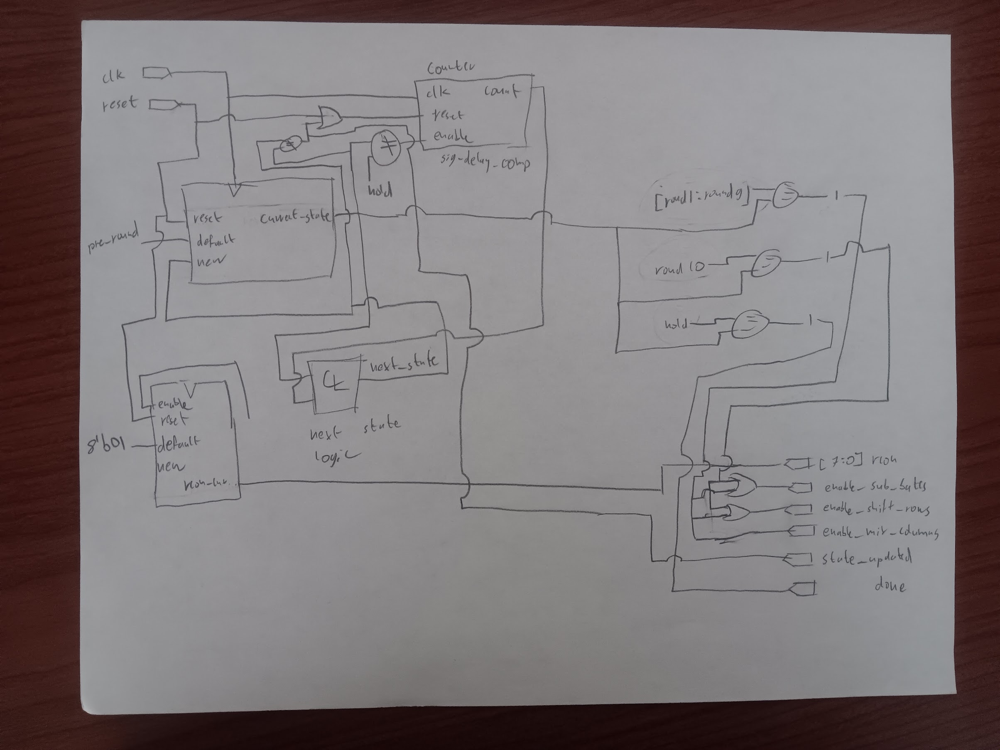

## Results and Discussion

The simulations all work without issues and the design even synthesizes in Radiant. Whilst debugging
my code, the vast majority of issues were related to the timing of signals. This makes sense because
we have not worked with complex timing too much in this class as of yet. The good news is that these
things are easy to find in the waveforms.

One bug of note was a baked-in timing assumption that the `load` signal would be asserted for more
clock cycles than it was in the `spi` testbench. Adding an extra cycle of delay at the start of the
pre-round solved this problem.

### Testbench Simulation

Both of the provided tests `core` and `spi` pass successfully. Expand the blocks below to see more details.

::: {.callout-note collapse="true"}
## Core Testbench Waveforms

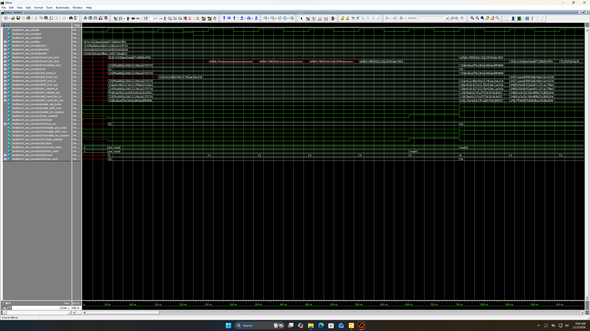

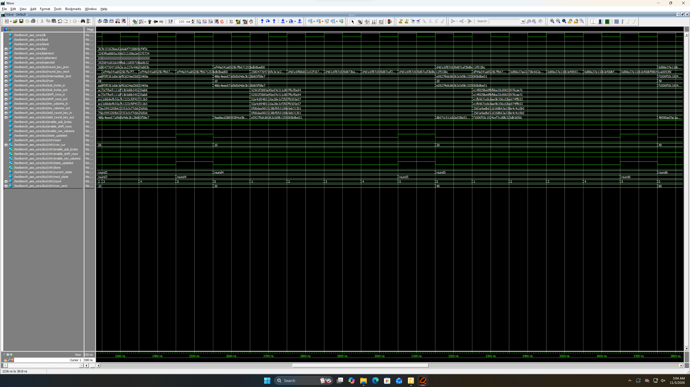

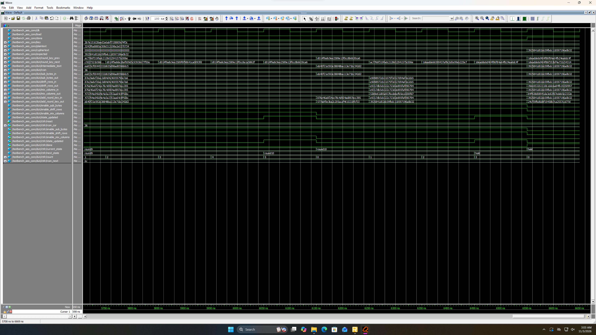

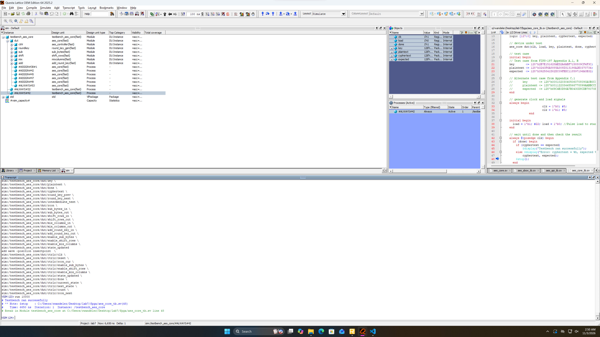
:::

::: {.callout-note collapse="true"}
## SPI Testbench Waveforms

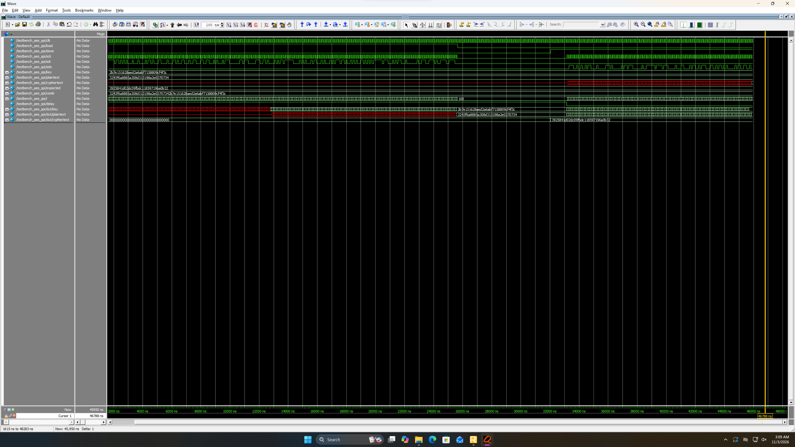

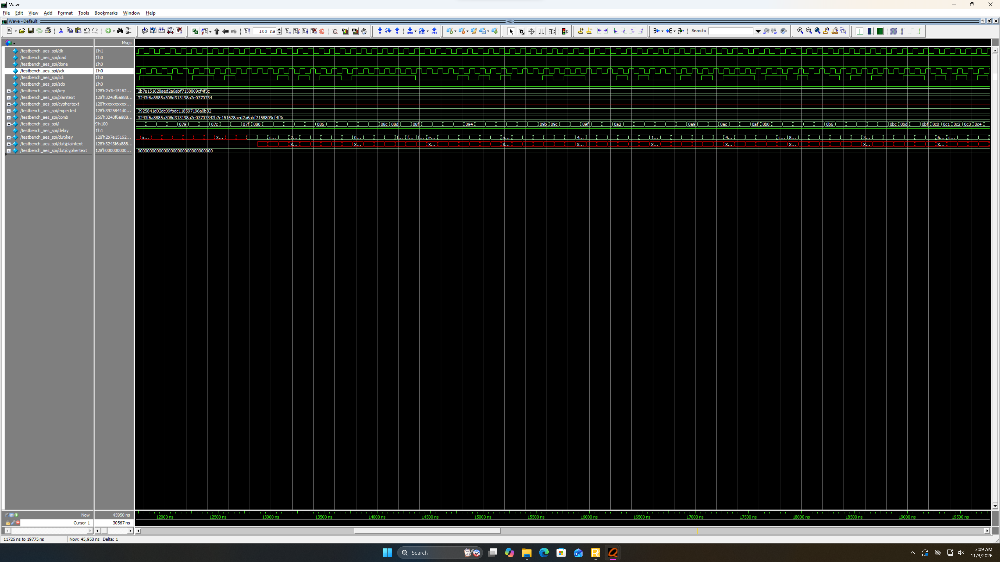

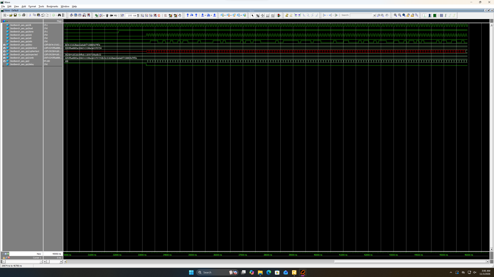

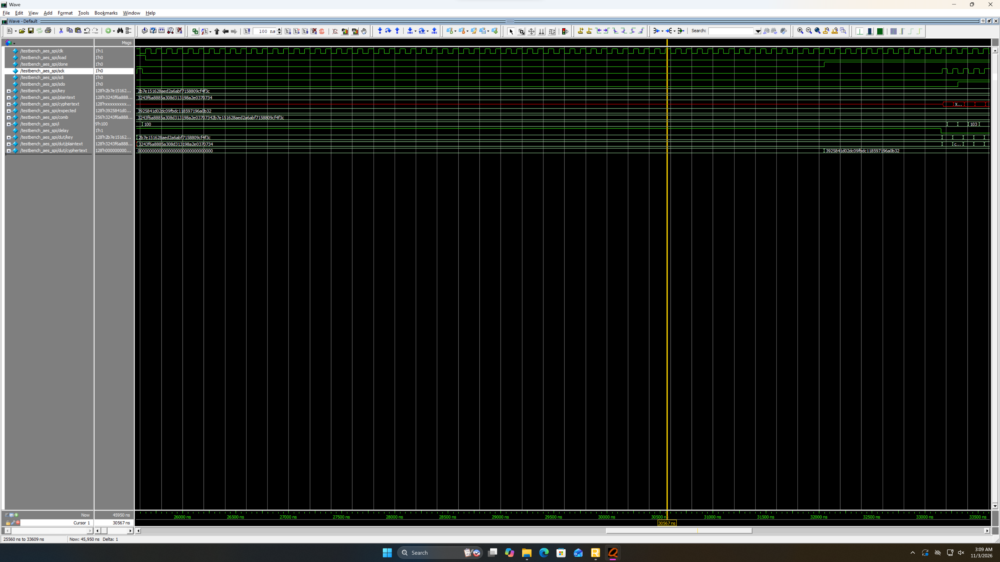

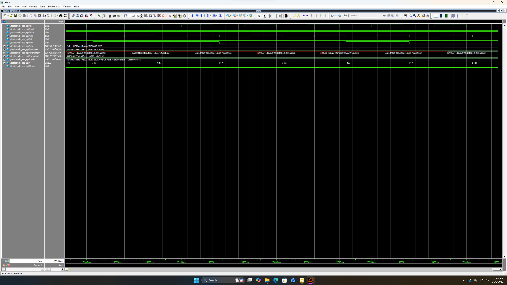

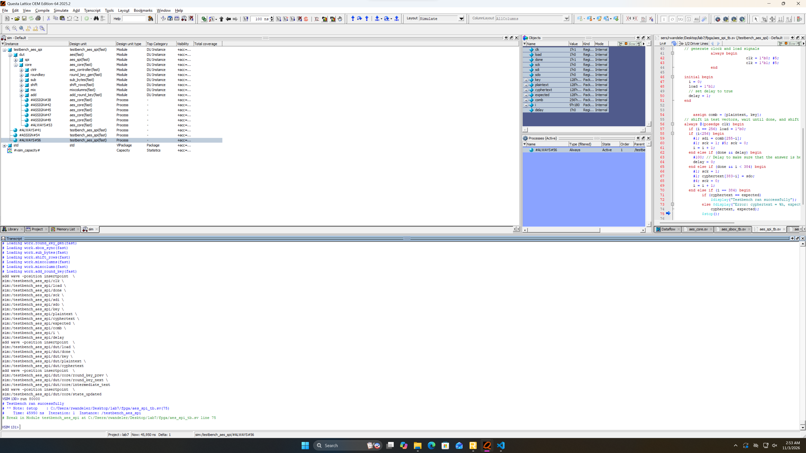
:::


## Conclusion
I managed to successfully implement the functionality required to meet the proficiency specification by the [lab
instructions](https://hmc-e155.github.io/lab/lab7/).

As mentioned at the top, I spent a total of around 12 hours on this lab.

### AI Prototype Summary
I chose to prompt google Gemini 3.1 Pro.

After feeding it the [AES Specification
PDF](https://hmc-e155.github.io/assets/doc/NIST.FIPS.197-upd1.pdf), the initial prompt that I used was:

> Write SystemVerilog HDL to implement the KeyExpansion logic described in the FIPS-197 uploaded
> document. The module should be purely combinational, using the previous key and current round
> number to calculate the next key. Assume other required modules (SubWord and RotWord) are already
> implemented.

The first thing that stood out to me was the spelling errors in some of the prose. Besides that
though, the code seems quite reasonable. I appreciate that the source splits the 128-bit key into
the 4 words (columns), as this makes the logic easier to parse. I should incorporate this into my
design going forward. One thing of note is that this code hard-codes the `rcon` values as opposed to
computing them or taking them in as an input. This might end up taking a few more logic elements but
this is probably negligible.

::: {.callout-note collapse="true"}
## First Prompt AI Response:

Here is the SystemVerilog implementation for the purely combinational AES-128 Key Expansion round,
based on the specifications in "NIST.FIPS.197-upd1.pdf". The implementation derives the next
128-bit round key from the previous 128-bit round key (four 32-bit words) and the current round
number. For AES-128 ($Nk=4$), the first word of the new key applies `SubWord`, `RotWord`, and the Round
Constant (`Rcon`), while the subsequent three words use a simple XOR with the newly generated previous
word.

````systemverilog
module KeyExpansion_128 (
    input  logic [127:0] prev_key,  // w[i-4], w[i-3], w[i-2], w[i-1]
    input  logic [3:0]   round_num, // round number (1 to 10)
    output logic [127:0] next_key   // w[i], w[i+1], w[i+2], w[i+3]
);

    // Internal 32-bit word signals
    logic [31:0] w0, w1, w2, w3;
    logic [31:0] next_w0, next_w1, next_w2, next_w3;
    logic [31:0] temp, rot_out, sub_out, rcon_word;

    // Unpack the previous 128-bit key into four 32-bit words
    assign {w0, w1, w2, w3} = prev_key;

    // 1. RotWord on w[i-1]
    RotWord rot_inst (
        .in_word (w3),
        .out_word(rot_out)
    );

    // 2. SubWord on the rotated word
    SubWord sub_inst (
        .in_word (rot_out),
        .out_word(sub_out)
    );

    // 3. Rcon calculation (only the most significant byte varies, based on x^(j-1))
    always_comb begin
        case (round_num)
            4'h1: rcon_word = 32'h01000000;
            4'h2: rcon_word = 32'h02000000;
            4'h3: rcon_word = 32'h04000000;
            4'h4: rcon_word = 32'h08000000;
            4'h5: rcon_word = 32'h10000000;
            4'h6: rcon_word = 32'h20000000;
            4'h7: rcon_word = 32'h40000000;
            4'h8: rcon_word = 32'h80000000;
            4'h9: rcon_word = 32'h1B000000;
            4'hA: rcon_word = 32'h36000000;
            default: rcon_word = 32'h00000000;
        endcase
    end

    // 4. Calculate the next 4 words
    always_comb begin
        // For i = 0 (mod Nk), temp is SubWord(RotWord(w[i-1])) XOR Rcon[i/Nk]
        temp    = sub_out ^ rcon_word;
        
        // w[i] = w[i-Nk] XOR temp
        next_w0 = w0 ^ temp;
        
        // For remaining words: w[i] = w[i-Nk] XOR w[i-1]
        next_w1 = w1 ^ next_w0;
        next_w2 = w2 ^ next_w1;
        next_w3 = w3 ^ next_w2;
    end

    // Pack the next words into the output 128-bit key
    assign next_key = {next_w0, next_w1, next_w2, next_w3};

endmodule
````

### Key Expansion Logic Details
- **Word Grouping**: The algorithm takes the previous 128-bit key and splits it into four 32-bit words.
- **Rcon Lookup**: The `Rcon` values inject a round-specific constant to eliminate symmetries, taking
  values based on polynomial multiplication in $GF(2^{8})$.
- **Transformation Functions**: `ROTWORD()` performs a cyclic permutation of the word's 4 bytes, while
  `SUBWORD()` applies the S-box substitution to each byte independently.
:::

In a new session with clean context, I then prompted the model with:

> Write SystemVerilog HDL to implement the following logic:
> 
> ````
> i = 0
> while i < Nk do
>     w[i] <- key[4*i..4*i+3]
>     i <- i+1
> end while
> while i <= 4 * Nr + 3 do
>     temp <- w[i-1]
>     if i mod Nk = 0 then
>         temp <- module1(module2(temp)) (+) Rcon[i/Nk]
>     else if Nk > 6 and i mod Nk = 4 then
>         temp <- module1(temp)
>     end if
>     w[i] <- w[i-Nk] (+) temp
>     i <- i + 1
> end while
> return w
> ````
> Assume module1 and module2 are existing modules that can be instantiated. (+) refers to XOR.
> Unwrap the loop in the provided pseudo code so it uses the previous iterations output to generate
> the new iteration.
> 
> Do not use any existing knowledge of the AES specifications in your answer.

This code is bad. For starters it is entirely combinational, so will not fit in the FPGA.
Additionally it uses older SystemVerilog keywords such as `wire`. It is also anything but easily
legible. Variable names are similar to the pseudocode, but not useful to someone reading it.

::: {.callout-note collapse="true"}
## Second Prompt AI Response:

Here is the SystemVerilog implementation that structuraly unrolls the provided pseudo-code loops
using `generate` blocks. Because `module1` and `module2` are defined as instantiate-able modules (rather
than functions), a `generate` loop is required to unroll the logic and chain the structural hardware
together.

````systemverilog
module logic_unroller #(
    parameter int Nk = 4,
    parameter int Nr = 10,
    parameter int WORD_WIDTH = 32
)(
    input  logic [7:0]          key  [0 : 4*Nk-1],
    input  logic [WORD_WIDTH-1:0] Rcon [0 : (4*Nr+3)/Nk],
    output logic [WORD_WIDTH-1:0] w    [0 : 4*Nr+3]
);

    genvar i;
    generate
        // Unwrap the first loop: i = 0 to Nk - 1
        // w[i] <- key[4*i..4*i+3]
        for (i = 0; i < Nk; i++) begin : gen_init_loop
            // Assuming concatenation to map 4 bytes into a single word
            assign w[i] = {key[4*i], key[4*i+1], key[4*i+2], key[4*i+3]};
        end

        // Unwrap the second loop: i = Nk to 4 * Nr + 3
        for (i = Nk; i <= 4 * Nr + 3; i++) begin : gen_calc_loop
            wire [WORD_WIDTH-1:0] temp_in;
            wire [WORD_WIDTH-1:0] mod1_out;
            wire [WORD_WIDTH-1:0] mod2_out;
            wire [WORD_WIDTH-1:0] temp_final;

            // temp <- w[i-1]
            assign temp_in = w[i-1];

            // if i mod Nk = 0 then
            if (i % Nk == 0) begin : gen_mod_0
                module2 u_module2 (
                    .in_data(temp_in),
                    .out_data(mod2_out)
                );
                
                module1 u_module1 (
                    .in_data(mod2_out),
                    .out_data(mod1_out)
                );
                
                // temp <- module1(module2(temp)) (+) Rcon[i/Nk]
                assign temp_final = mod1_out ^ Rcon[i/Nk];
            end
            
            // else if Nk > 6 and i mod Nk = 4 then
            else if (Nk > 6 && (i % Nk == 4)) begin : gen_mod_4
                module1 u_module1 (
                    .in_data(temp_in),
                    .out_data(mod1_out)
                );
                
                // temp <- module1(temp)
                assign temp_final = mod1_out;
            end
            
            // Unspecified implicit else branch (temp remains unchanged)
            else begin : gen_mod_default
                assign temp_final = temp_in;
            end

            // w[i] <- w[i-Nk] (+) temp
            assign w[i] = w[i-Nk] ^ temp_final;
        end
    endgenerate

endmodule
````

#### Key Implementation Details:
1. **Unwrapping the Loop**: The `genvar` and `generate for` loops construct hardwired instances iteratively
   at compile time. Instead of a clocked loop in a state machine, the combinational paths
   automatically chain outputs of iteration `i-1` and `i-Nk` into the hardware for iteration `i`.
2. **Conditional Hardware Instantiation**: The `if / else if / else` statements inside the generate
   block dictate whether the synthesizer places `module1` and `module2`, just `module1`, or just a wire
   pass-through for `temp` at each specific iteration step index.
3. **Module Interconnections**: To adhere to the requirement of instantiating modules, I utilized
   intermediatery `wire` types inside each unrolled index block.
4. **Data Sizing**: I used a generalized parameterized word mapping, where `key` is packed
   sequentially 4-bytes at a time per index based on your `[4*i..4*i+3]` array bounds.
:::

LLM's are good at generating code/prose for problems that already have been solved. When presented
with the AES specification (along with the knowledge of AES), the code was clean and easy to parse.
When it was generated with random pseudocode and specifically instructed to not interpret it as AES,
it was a mess. When working with an LLM to develop code for a project, it would definitely be worth
refining prompts and context to the problem prior to solving it. I assume that running the second
prompt through an LLM for a few rounds could refine it (especially the pseudocode) into a state that
yields more satisfactory results when fed to the LLM.

